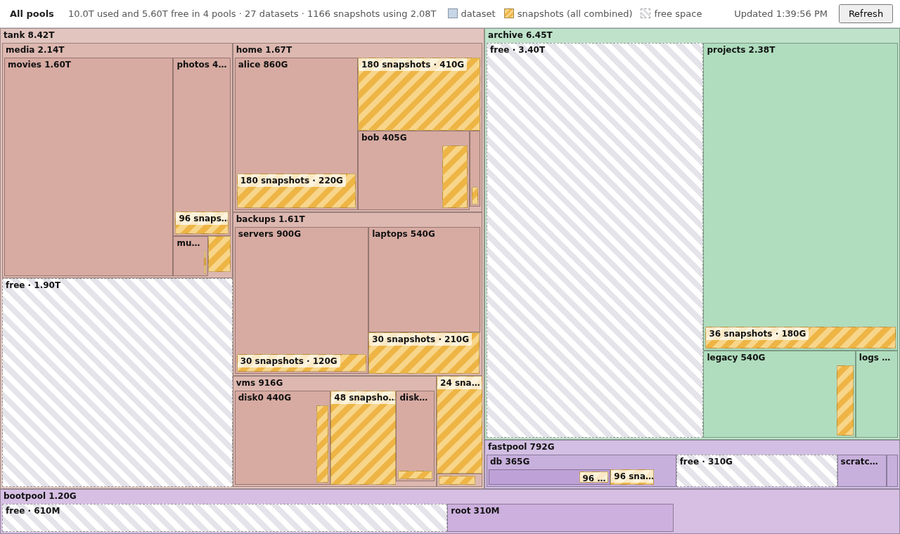

# zfstreemap

A small web app that shows how ZFS space is used, as a treemap. Each dataset is a
box sized by the space it uses, and child datasets are nested inside their parent.
Each dataset's snapshots are combined into a single block, so there is no
per-snapshot clutter. Each pool also shows its free space as a block.



## Requirements

- Python 3.9 or newer (standard library only, no pip dependencies)
- The `zfs` command on `PATH`, readable by the user running the server
  (`zfs list` must work for that user)

## Running

From a checkout:

```sh
python3 -m zfstreemap              # http://127.0.0.1:8080/
python3 -m zfstreemap --port 9000
```

Or install it and use the `zfstreemap` command:

```sh
pip install .
zfstreemap --host 127.0.0.1 --port 8080
```

Open the address in a browser.

The server only shows dataset names, sizes, and snapshot dates. It binds to
`127.0.0.1` by default. Use `--host 0.0.0.0` only if you want other machines on
your network to see that information.

## Using the page

- **Hover** a box for its details: space used, own data, snapshot count and
  date range, child count, and mountpoint.
- **Click** a dataset (its name bar, its padding, or its own-data block) to zoom
  in. Use the breadcrumb trail, or press **Escape**, to zoom back out.
- **Refresh** re-queries ZFS. A spinner in the middle of the screen shows while
  the query runs. The page also re-lays out when the window is resized.

Colours are per pool. Within a dataset, the blocks are:

| Block | Meaning |
| --- | --- |
| Dataset box, with its name in the top bar | Total space used by the dataset (`used`) |
| Striped block, labelled "N snapshots" | All snapshots of the dataset combined (`usedbysnapshots`) |
| Dashed, hatched block, labelled "free" | Free space in the pool (`available` on the pool's root dataset). Only pools have one. |
| Unshaded area inside a dataset box | The dataset's own data, not in its snapshots or children. It has no block of its own. |

A dataset's box area is split exactly into these parts and its child datasets,
so the sizes add up at every level. A pool's box is its used space plus its free space.

## How it works

`zfstreemap/zfs.py` runs two commands and lets them run concurrently:

- `zfs list -H -p -t filesystem,volume -o name,type,used,usedbysnapshots,referenced,mountpoint`
- `zfs list -H -p -t snapshot -o name,creation`

It builds the tree from the dataset names. A dataset's own space is what remains
of its `used` after its snapshot space and its children's `used` are subtracted.
The pool's root dataset also provides `available`, which becomes the pool's free block.
The server exposes the tree at `/api/tree`. The browser does the treemap layout
(squarified) and drawing, so there's no image rendering on the server.

There is no pure-Python ZFS binding that works without the C libraries, so the
prototype uses the command-line tool. The `-H -p` flags give stable,
machine-readable output.

## Known limitations

- Listing snapshots is slow on pools with many of them. A refresh took about 6
  seconds with 5,300 snapshots, and the time grows with the snapshot count.
- Tiny boxes (less than 2 px) are not drawn, so a pool with hundreds of small
  datasets shows only some of them at a time. Zoom in to see more.
- Bookmarks are not included.

## Tests

```sh
python3 -m unittest
```

The tests use fake `zfs` output and do not need ZFS installed.
